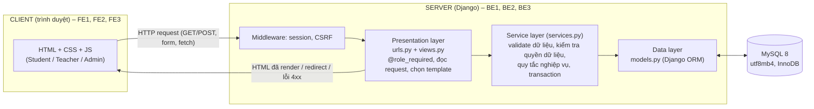

# Kiến trúc hệ thống – Client–Server (theo SRS mục II.5 "Development")

SRS yêu cầu: client gửi request, server xử lý logic nghiệp vụ, giao tiếp với database, **server phải validate dữ liệu và kiểm tra quyền trước mọi thao tác trên dữ liệu**.

## 1. Sơ đồ tổng quan

## 2. Trách nhiệm từng tầng (quy tắc để 6 người không dẫm chân nhau)

| Tầng | Nằm ở | Được làm | KHÔNG được làm | Người làm |
|---|---|---|---|---|
| Client | `templates/`, static JS/CSS | Hiển thị, validate sơ bộ cho tiện (trường rỗng, định dạng), dialog xác nhận, tô đỏ ô sai, gọi request | Tin vào dữ liệu phía client, tự quyết quyền truy cập, tự tính kết quả cuối cùng (JS chỉ tính tạm để xem trước) | FE1, FE2, FE3 |
| Presentation | `views.py`, `urls.py` | Gắn `@role_required`, đọc request, gọi service, bắt `ServiceError`, chọn template/redirect, `messages` | Chứa quy tắc nghiệp vụ, truy vấn ORM phức tạp | BE (chủ app) |
| Service | `services.py`, `grades/calculator.py` | Mọi quy tắc nghiệp vụ, **validate lại ở server**, **kiểm tra quyền trên dữ liệu** (GV có dạy section? SV có phải chủ bản ghi?), transaction, ghi log | Biết gì về HTTP/template | BE (chủ app) |
| Data | `models.py`, migration | Định nghĩa bảng, ràng buộc unique/FK | Chứa logic nghiệp vụ | **Chỉ BE1** |
| Database | MySQL | Lưu dữ liệu, khóa dòng, ràng buộc | – | BE1 (schema, seed) |

**Quy tắc 2 lớp bảo vệ (đáp ứng SRS II.4 và II.5):**
1. Lớp view: `@role_required(...)` chặn sai role (chưa đăng nhập → trang login, sai role → 403).
2. Lớp service: kiểm tra quyền theo dữ liệu (ví dụ `teacher_teaches_section`, sinh viên chỉ truy cập `Enrollment` của chính mình). Không bao giờ chỉ ẩn nút ở giao diện.

## 3. Luồng một request điển hình: Đăng ký học phần (UC 7)

1. **Client:** SV bấm Register → hộp thoại xác nhận (3.4) → `POST /registration/sections/<id>/register/` kèm CSRF token.
2. **Server – middleware:** kiểm tra session và CSRF.
3. **View `register_view`:** `@role_required(STUDENT)` → gọi `register_section(student, section_id)`.
4. **Service:** `transaction.atomic()` → `validate_registration` (kỳ đăng ký, còn chỗ, chưa đăng ký, trùng lịch, tiên quyết) → cập nhật sĩ số nguyên tử → tạo `Enrollment`.
5. **Data:** ORM ghi MySQL; nếu lỗi bất kỳ thì rollback (SRS II.2: lỗi thì không đổi dữ liệu).
6. **Response:** redirect về 3.5 kèm message thành công, hoặc quay lại 3.3 kèm lý do lỗi (`ErrorCode`).

## 4. Quy ước giao tiếp Client ↔ Server

| Nội dung | Quy ước |
|---|---|
| Xem dữ liệu | `GET`, tham số lọc/phân trang trên query string: `?q=&page=` |
| Thay đổi dữ liệu | `POST` (có CSRF), sau khi xong `redirect` (tránh gửi lại form) |
| Phân trang | Server cắt trang (`PAGE_SIZE=10`), trả `page_info` cho template (SRS: các danh sách phải phân trang) |
| Lỗi nghiệp vụ | Service `raise ServiceError(code, message)` → view đưa vào `messages`; FE hiển thị đúng chữ trong GUI |
| Lỗi quyền | HTTP 403; chưa đăng nhập: redirect `/accounts/login/` |
| Mật khẩu | Băm PBKDF2, không bao giờ trả về client; mật khẩu tạm chỉ hiện một lần cho Admin |
| Hợp đồng từng màn hình | `docs/api/<app>.md` (URL, quyền, context, hành động, mã lỗi) |

## 5. Triển khai và môi trường

- Client: trình duyệt hiện đại (Chrome/Firefox). Server: Django `runserver` khi phát triển; khi demo/test tải dùng `gunicorn` (nhiều worker) để tiến gần mục tiêu 500 người dùng đồng thời.
- Database: MySQL 8 trong Docker (`docker compose up -d`), mỗi người một DB cục bộ, schema thống nhất bằng migration, dữ liệu bằng seed.
- Hiệu năng (SRS II.3): đăng nhập, tìm kiếm, xem điểm < 3 giây → dùng `select_related`/`prefetch_related`, index cho `student_code`, `full_name`, `student_class`, `major`; phân trang ở DB, không tải cả bảng.

## 6. Khớp với 4 lớp trong SRS

| Thành phần SRS | Vị trí trong code |
|---|---|
| Use-case (III) | hàm trong `services.py` + `views.py` |
| Class diagram (IV) | `models.py` + `common/contract.py` (enum, hằng số) |
| DFD, 5 data store (V) | Accounts → `accounts`; Students → `students`; Courses → `courses`; Enrollment → `registration`; Grades → `grades` |
| 6 process DFD 1.0–6.0 | 1.0 `accounts`, 2.0 `students`, 3.0 `search`, 4.0 `courses`, 5.0 `registration`, 6.0 `grades` |
